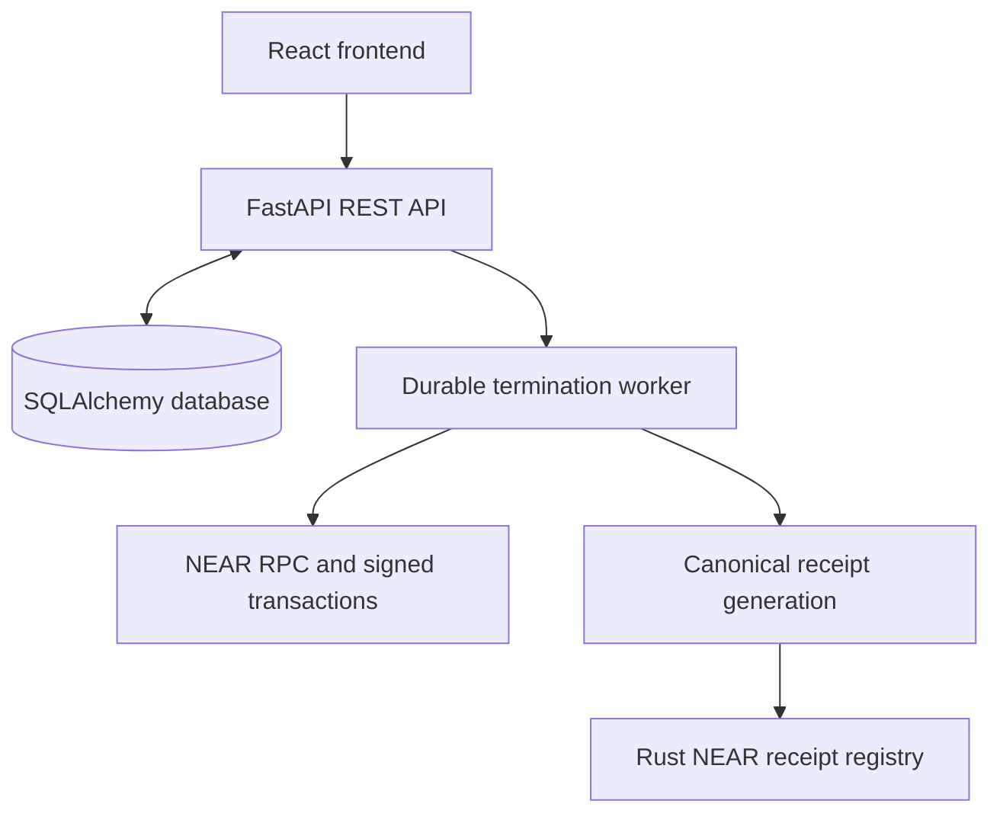

# Clean Exit

**Agent authority termination and verification infrastructure on NEAR.**

Clean Exit helps developers revoke supported permissions granted to AI agents and produce independently verifiable evidence of what happened.

Stopping an AI agent does not necessarily revoke its permissions. NEAR function-call access keys and other credentials may remain active after the agent stops running.

Clean Exit provides a structured authority registry, a durable termination workflow, real NEAR access-key revocation, and cryptographic receipts committed to a NEAR smart contract.

[](https://x.com/l0rdWells/status/2118026646813094290)

## Project at a glance

| Property | Value |
|---|---|
| Project | Clean Exit |
| Category | AI Agent Security and Authority Management |
| Blockchain | NEAR |
| Tested network | NEAR testnet |
| Backend | Python, FastAPI, SQLAlchemy |
| Frontend | React, Vite, TypeScript, Tailwind CSS |
| Smart contract | Rust, near-sdk |
| SDK and CLI | Python |
| Automated revocation | NEAR function-call access keys |
| Receipt integrity | Canonical JSON + SHA-256 |
| On-chain registry | `clean-exit-registry-587840.testnet` |
| License | MIT |

## The problem

AI agents often receive permissions to perform tasks: access keys, API credentials, delegated capabilities, and other forms of authority.

When an agent is stopped, those permissions do not necessarily disappear.

This creates a security gap between terminating an agent's execution and revoking the authority it was granted.

Clean Exit addresses that gap by making agent termination an explicit, inspectable, and verifiable process.

Instead of simply reporting that an agent has stopped, Clean Exit records:

- Which authorities were registered.
- Which permissions can be handled automatically.
- Which revocation operations were attempted.
- Which operations succeeded or failed.
- Which permissions remain unresolved.
- What evidence was generated and committed on-chain.

## What Clean Exit does

### 1. Agent and authority registry

Register agents associated with NEAR accounts and attach known authorities to them.

Authorities form a directed graph, allowing Clean Exit to represent parent-child relationships, detect cycles, and identify orphaned entries.

### 2. Real NEAR access-key revocation

Clean Exit can delete supported NEAR function-call access keys through signed transactions.

The backend constructs and submits NEAR transactions using Borsh serialization and Ed25519 signing.

After a deletion, it queries the account again to confirm whether the key is absent.

A submitted transaction is not automatically considered a successful revocation. The result must be checked.

### 3. Durable termination worker

Termination runs asynchronously through a background worker.

The workflow has eight phases:

```text
Validate
   ↓
Inventory
   ↓
Plan
   ↓
Revoke
   ↓
Resolve Obligations
   ↓
Verify
   ↓
Finalize
   ↓
Complete
```

Jobs are persisted in the database. The worker supports retries, idempotency, heartbeat tracking, and stale-lock recovery.

Per-key post-revocation verification occurs during the revocation operation. The separate `verify` phase does not perform an additional job-level reconciliation.

### 4. Cryptographic receipts

After termination, Clean Exit generates a canonical JSON receipt payload and calculates its SHA-256 hash.

The hash can be published to the deployed NEAR receipt registry.

The verification process recomputes the payload hash and compares it with the commitment stored on-chain.

This allows an independent observer to check whether the receipt payload matches the recorded commitment.

Importantly, verifying a receipt's hash proves payload integrity. It does not independently establish that every real-world permission has been revoked.

### 5. Developer tools

Clean Exit includes:

- A React frontend for managing agents and inspecting termination workflows.
- A Python SDK for programmatic access.
- A command-line interface with JSON output.
- A FastAPI REST API documented through OpenAPI.

## How NEAR fits into Clean Exit

NEAR is used for two distinct operations.

**Permission revocation:** The backend submits signed NEAR transactions to delete supported function-call access keys from an account.

**Receipt verification:** A Rust smart contract stores receipt commitments. Its view methods allow anyone to retrieve and compare the recorded hashes.

The contract is not a general permission manager. Actual access-key deletion happens through NEAR account transactions. The contract provides an independently inspectable record of receipt commitments.

## Try Clean Exit locally

The current project provides a local testing environment. It is not a hosted public demo.

### Prerequisites

- Python 3.12 or later.
- Node.js 18 or later.
- Rust and Cargo, if running contract tests or rebuilding the contract.
- A NEAR testnet account.
- A testnet full-access signing key authorized to manage the account's access keys.

For a real revocation, use a disposable testnet account and a separate restricted function-call key. Never target the full-access key used by the backend signer.

### 1. Clone the repository

```bash
git clone https://github.com/boycisco/clean-exit.git
cd clean-exit
```

Replace the repository URL with the actual public repository address.

### 2. Configure the backend

Create a virtual environment and install the dependencies.

**Windows PowerShell:**

```powershell
py -m venv venv
.\venv\Scripts\Activate.ps1
python -m pip install --upgrade pip
pip install -e ".[dev]"
Copy-Item .env.example .env
```

**Linux / macOS:**

```bash
python3.12 -m venv venv
source venv/bin/activate
python -m pip install --upgrade pip
pip install -e ".[dev]"
cp .env.example .env
```

Edit `.env` and configure the required settings.

Apply database migrations:

```bash
alembic upgrade head
```

Start the backend:

```bash
uvicorn app:app --reload
```

The API should be available at:

```text
http://127.0.0.1:8000
```

Check that it is running:

```text
GET /health
GET /api/v1/capabilities
```

The capabilities endpoint reports which operations are enabled, including signer and receipt publisher availability.

### 3. Start the frontend

Open another terminal:

```bash
cd ui
npm install
npm run dev
```

Open the local URL printed by Vite.

The connection screen accepts:

- **Server address:** `http://127.0.0.1:8000`
- **Access token:** the configured `BOOTSTRAP_TOKEN` from your local `.env`, when using the bootstrap authentication flow.

Use a unique local development token. Never deploy the example development token or publish credentials.

### 4. Configure NEAR testnet access

The backend needs an authorized signer to execute real key revocations.

Important environment variables:

| Variable | Purpose |
|---|---|
| `NEAR_NETWORK` | Selects `testnet` or `mainnet` |
| `NEAR_SIGNER_ACCOUNT` | NEAR account authorized to sign revocation transactions |
| `NEAR_SIGNER_KEY_PATH` | Server-side signing key path |
| `RECEIPT_CONTRACT` | Deployed receipt registry account |
| `RECEIPT_PUBLISHER_ACCOUNT` | Account authorized to publish receipt commitments |
| `RECEIPT_PUBLISHER_KEY_PATH` | Publisher signing key path |
| `BOOTSTRAP_TOKEN` | Initial API authentication token |

The signing account and receipt publisher require their own appropriate permissions.

For the test workflow, ensure that the target function-call key belongs to the account being managed and is not the signer's own access key.

Receipt publication requires the contract and publisher configuration. Read-only verification of previously published receipts does not require the publisher signing key.

Keep all private keys outside the repository.

## Perform a real termination

Once the backend, worker, and frontend are configured, use a disposable NEAR testnet account.

### Expected workflow

| Step | Action | Expected result |
|---|---|---|
| 1 | Register an agent | Agent appears in the dashboard |
| 2 | Add a NEAR function-call key | Authority appears in the inventory |
| 3 | Verify authority | Backend confirms the key exists on-chain |
| 4 | Inspect termination plan | Supported and unsupported actions are identified |
| 5 | Terminate the agent | A durable termination job is created |
| 6 | Observe job execution | Worker processes the termination phases |
| 7 | Verify revocation | The target key is confirmed absent |
| 8 | Inspect receipt | Canonical receipt payload and hash are available |
| 9 | Publish receipt | Hash commitment is submitted to the registry |
| 10 | Verify integrity | On-chain commitment matches the recomputed receipt hash |

A `202 Accepted` response means the termination job was created. It does not mean termination succeeded.

The final outcome is determined by the receipt result:

- `clean`: all registered authorities within the termination scope were resolved.
- `partial`: one or more authorities remain unresolved, unsupported, skipped, or failed.
- `failed`: a trustworthy outcome could not be established.

A successful worker job is not necessarily a clean termination.

## What Clean Exit does not claim

Security infrastructure must be precise about its guarantees.

**No universal permission discovery.**

Clean Exit does not automatically discover every permission an agent has. Operators register known authorities, and supported verification operations can confirm their state on-chain.

An empty authority inventory does not mean an agent has no permissions.

**No complete revocation of every permission.**

Automated revocation is currently limited to `near_function_key` authorities.

Other registered authority types, including scheduled jobs, external credentials, obligations, and child delegations, are reported but are not automatically resolved by the current implementation.

**No automatic obligation resolution.**

The obligation phase collects unresolved items for manual action. It does not settle, cancel, or resolve obligations automatically.

**No separate job-level final reconciliation.**

Post-revocation verification occurs per attempt. There is no additional reconciliation pass between revocation and finalization.

Skipped, failed, and unresolved attempts prevent a clean result.

**No mainnet deployment.**

The deployed registry and verified transaction evidence are on NEAR testnet. Mainnet readiness has not been established.

**No production-hardening claim.**

Rate limiting is not implemented in the current deployment. Token revocation is database-only, and PostgreSQL compatibility has not been exercised by the test suite.

## On-chain evidence

The receipt registry has been deployed to NEAR testnet.

| Property | Verified value |
|---|---|
| Network | NEAR testnet |
| Contract account | `clean-exit-registry-587840.testnet` |
| Deployment transaction | `DpKfKDJ7KTsyRMApDLx5vPtpqEJVBd2na2MFu745Kgkz` |
| Published receipt transaction | `J7Ukfj5vdaoXa4siT8RznHSJPRFYJgkv3Top7ND13pb3` |
| Wasm SHA-256 | `96c727a0d9704cb529bebe25041419ba81527ef39559476886b531294d007adc` |
| Wasm size | 118,801 bytes |
| Published payload hash | `ec8bb6d5c2c271a0f9fe78eeef5bbffcf4c676d77c98cfd92817aaea8666c0e9` |

These values are historical testnet evidence from the project's verification work.

### Independently inspect the contract

Install and configure the NEAR CLI, then run:

```bash
near contract call-function as-read-only clean-exit-registry-587840.testnet count json-args '{}' network-config testnet now
```

Expected result during the recorded verification: `1`.

Inspect the contract owner:

```bash
near contract call-function as-read-only clean-exit-registry-587840.testnet owner json-args '{}' network-config testnet now
```

Expected result:

```text
clean-exit-registry-587840.testnet
```

The published receipt transaction and payload hash can also be inspected using NEAR testnet RPC and the contract's `get` view method.

See [`docs/deploy.md`](docs/deploy.md) for deployment and verification details.

### What the receipt proves

There are three different claims:

1. **Payload integrity:** the stored receipt produces the expected SHA-256 hash.
2. **On-chain commitment:** the deployed contract contains that hash.
3. **Revocation outcome:** the receipt describes what happened to the registered authorities.

The first two can be checked cryptographically. They do not prove that every permission an agent possesses has been removed.

## Testing

Clean Exit separates offline application tests from live read-only network checks.

Run commands from the repository root unless otherwise specified.

### Backend tests

```bash
pytest -v
```

The last recorded run completed with:

```text
185 passed, 4 deselected
```

This suite includes backend, authentication, termination, receipt, SDK, and CLI tests. Most external HTTP interactions are mocked.

### Live NEAR testnet tests

```bash
pytest -m live -v
```

Last recorded result:

```text
4 passed, 185 deselected
```

These tests perform read-only queries against NEAR testnet. They do not execute destructive revocations or publish receipts.

### Database migration check

```bash
alembic check
```

Last recorded result: no new upgrade operations detected.

### Frontend

From the `ui/` directory:

```bash
npm run lint
npm run build
```

Both commands passed in the last recorded validation.

### Rust contract

From `contract/registry/`:

```bash
cargo test --lib
```

Last recorded result:

```text
7 passed, 0 failed
```

On Windows, contract tests currently require the workaround documented in `docs/deploy.md`. Linux/macOS integration tests have not been run in the reported validation.

### End-to-end scripts

The repository also includes scripts for exercising the SDK and CLI against a running backend.

These workflows can submit real testnet transactions. Use only disposable testnet accounts and function-call keys.

Python SDK:

```bash
python scripts/e2e_sdk.py "ed25519:YOUR_TEST_PUBLIC_KEY"
```

PowerShell CLI:

```powershell
.\scripts\e2e_cli.ps1 -TargetKey "ed25519:YOUR_TEST_PUBLIC_KEY"
```

Do not run these against mainnet or against a key you cannot safely revoke.

### Test coverage boundaries

The reported automated live tests are read-only. The real access-key revocation and receipt publication were performed manually during development and verified against testnet.

There is no automated destructive live test in the current suite.

PostgreSQL compatibility is also unverified; SQLite is the database exercised by the reported tests.

## Architecture



| Component | Responsibility |
|---|---|
| FastAPI backend | REST API, authentication, ownership enforcement, capabilities |
| SQLAlchemy + Alembic | Database models, persistence, and migrations |
| Durable worker | Termination jobs, retries, stale-lock recovery |
| NEAR transaction layer | Borsh serialization, Ed25519 signing, transaction submission, verification |
| Rust registry contract | Append-only receipt commitment storage and verification |
| React frontend | Agent management, authority inspection, termination workflow |
| Python SDK | Typed API client and job polling |
| Python CLI | Command-line operations and machine-readable JSON output |

### Repository structure

```text
clean-exit/
├── app.py
├── config.py
├── database.py
├── models.py
├── schemas.py
├── auth.py
├── agents.py
├── authority.py
├── termination.py
├── near.py
├── signer.py
├── receipts.py
├── jobs.py
├── audit.py
├── errors.py
├── probe.py
├── tests/
├── migrations/
├── contract/
│   └── registry/
│       ├── src/
│       └── tests/
├── docs/
│   ├── api.md
│   └── deploy.md
├── sdk/
│   ├── client.py
│   └── cli.py
├── ui/
├── scripts/
├── pyproject.toml
├── .env.example
├── LICENSE
└── README.md
```

## Technical documentation

- [`docs/api.md`](docs/api.md): API endpoints, authentication, request and response formats, state machines, and error behavior.
- [`docs/deploy.md`](docs/deploy.md): NEAR testnet deployment and verification instructions.
- [`sdk/client.py`](sdk/client.py): Python SDK implementation.
- [`sdk/cli.py`](sdk/cli.py): CLI implementation.
- `/docs`: Interactive FastAPI documentation when the backend is running.
- `/openapi.json`: Generated OpenAPI schema.

## Security

- Owner isolation is enforced server-side.
- API tokens are stored as SHA-256 hashes, not raw token values.
- The backend prevents the signer from revoking the key it uses to authorize transactions.
- RPC failures do not produce fabricated evidence that an authority is absent.
- Unsupported and inconclusive results remain distinct from successful revocation.
- Signing keys and environment secrets must remain outside version control.

Never commit `.env` files, private keys, seed phrases, or credentials.

## License

Clean Exit is released under the MIT License.

See [`LICENSE`](LICENSE).