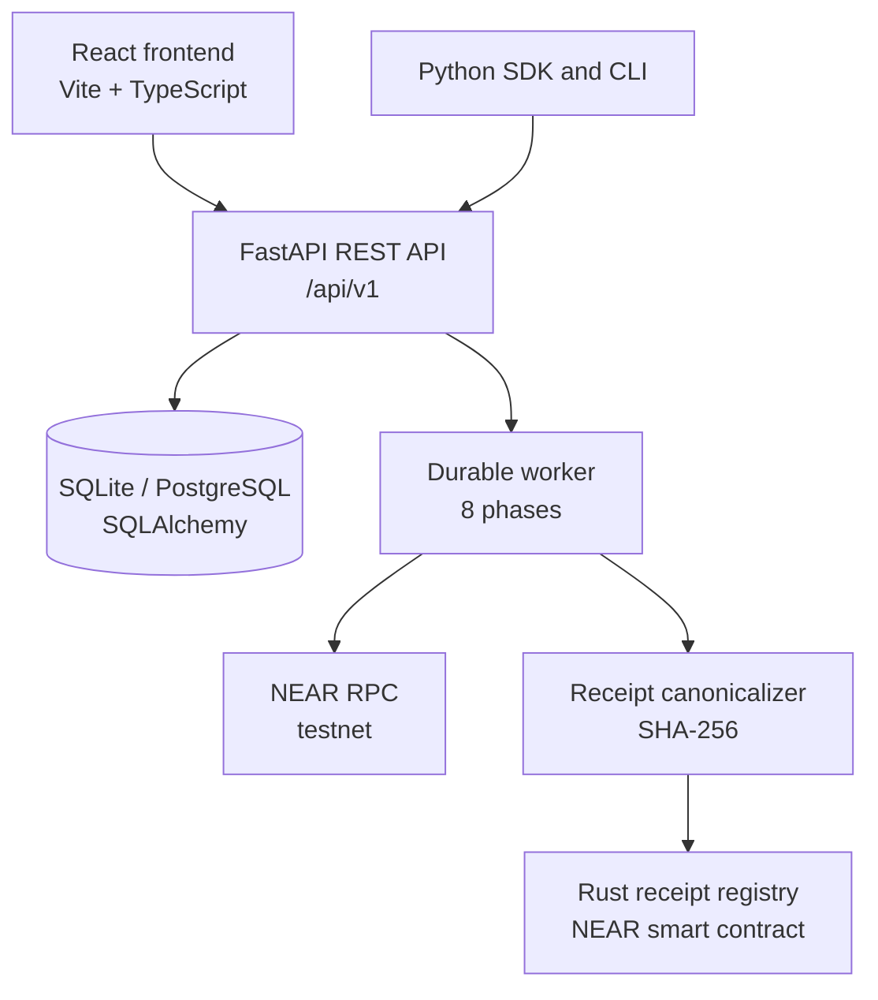

# Clean Exit

**Agent authority termination and verification infrastructure on NEAR.**

## The Problem

When an AI agent finishes a task, its permissions often outlive it. API keys, NEAR function-call access keys, token allowances, scheduled jobs, and delegated authorities can remain active after the agent is “stopped.” Existing shutdown mechanisms do not provide a unified, independently verifiable record of what was revoked, what remains active, and what could not be cleaned up.

Clean Exit addresses this by providing:

- A **structured authority registry** for agents and the permissions they hold.
- A **termination workflow** that inspects, plans, and executes revocations against supported on-chain permissions.
- **Durable, resumable jobs** that survive crashes and retries.
- **Independently verifiable receipts** whose canonical SHA-256 hashes are published to a NEAR smart contract.

## What Clean Exit Does — and Doesn't Do

### Clean Exit does

- Register AI agents tied to a NEAR account on testnet or mainnet.
- Track registered authorities as a directed graph, with cycle detection and orphan reporting.
- **Delete real NEAR function-call access keys** via signed, Borsh-serialized transactions. This has been verified on testnet; see [On-Chain Evidence](#on-chain-evidence-testnet).
- Run a durable termination worker with eight phases, retries, and stale-lock recovery.
- Perform per-key post-revocation verification by re-querying the account.
- Generate a canonical SHA-256 receipt payload with deterministic serialization.
- Publish the receipt hash to the deployed registry contract.
- Verify that the on-chain hash matches a locally recomputed hash.
- Provide a React frontend, a Python SDK, and a CLI.

### Clean Exit does not claim

- **Universal permission discovery.** The registry only knows about authorities that an operator registered or that the verification endpoint confirmed on chain. It does not discover external API keys, third-party credentials, or off-chain allowances.
- **Complete revocation of every permission.** Only `near_function_key` authorities are automatically revocable by the shipped code. Child delegations, scheduled jobs, external credentials, and obligations are reported but not automatically resolved.
- **Automatic obligation resolution.** `phase_resolve_obligations` collects unresolved obligations into `manual_items`; it does not settle or cancel them.
- **Job-level final reconciliation.** Per-attempt verification happens after each revocation. There is no separate final verification pass after `phase_verify`; the classification logic determines the final outcome.
- **Mainnet readiness.** All verification and publication evidence is testnet-only. Mainnet signing is disabled unless `APP_ENV=production`.
- **Production hardening.** There is no rate limiting, no admin API for token revocation (revocation is database-only), and PostgreSQL compatibility is claimed but untested.

## Architecture



- **FastAPI backend** — REST API under `/api/v1`, Bearer-token authentication, owner isolation, and capability discovery.
- **Database and migrations** — SQLAlchemy 2.x with Alembic; SQLite for local development and a PostgreSQL-compatible schema (PostgreSQL itself is not tested).
- **Durable worker** — Claims pending jobs, drives eight phases, retries transient failures, and recovers stale locks.
- **NEAR transaction layer** — Borsh serialization, Ed25519 signing, `broadcast_tx_commit` submission, and post-check verification.
- **Rust receipt registry** — Append-only `LookupMap` of receipt commitments, owner-gated `publish`, and a `verify` view function.
- **React frontend** — Vite, TypeScript, and Tailwind; typed API integration against the OpenAPI schema.
- **Python SDK and CLI** — Thin client over the REST API, with a polling helper and JSON output.

## Repository Structure

```text
.
├── app.py                 # FastAPI app and lifespan (bootstrap owner, worker)
├── config.py              # Environment settings
├── database.py            # Async engine, sessions, WAL pragma
├── models.py              # SQLAlchemy models
├── schemas.py             # Pydantic schemas
├── auth.py                # Bearer token and ownership dependencies
├── agents.py              # Agent endpoints
├── authority.py           # Authority endpoints, revocation, verification
├── termination.py         # Planner, job endpoints, eight-phase engine
├── near.py                # NEAR JSON-RPC client, Borsh, transaction construction
├── signer.py              # Ed25519 key loading and signing
├── receipts.py            # Canonical payload, publication, verification
├── jobs.py                # Worker loop, job claiming, recovery
├── audit.py               # Append-only audit events
├── errors.py              # Unified error envelope
├── probe.py               # Read-only NEAR testnet connectivity check
├── tests/                 # pytest suites
├── migrations/            # Alembic migrations
├── contract/
│   └── registry/          # Rust receipt registry contract
│       ├── src/lib.rs
│       └── tests/integration.rs
├── docs/
│   ├── api.md              # API contract
│   └── deploy.md           # Testnet deployment notes
├── sdk/
│   ├── client.py           # Python SDK
│   └── cli.py              # Command-line interface
├── ui/                     # React frontend
├── pyproject.toml
├── .env.example
└── README.md
```

## Setup

### Prerequisites

- **Python 3.12 or later**
- **Node.js 18 or later** for the frontend
- **Rust** only if you need to rebuild or test the contract

### Backend

From the repository root, create and activate a virtual environment, then install the project dependencies.

```bash
python -m venv venv
```

Windows PowerShell:

```powershell
.\venv\Scripts\Activate.ps1
```

macOS/Linux:

```bash
source venv/bin/activate
```

Install dependencies and create your local environment file:

```bash
pip install -e ".[dev]"
```

Windows PowerShell:

```powershell
Copy-Item .env.example .env
```

macOS/Linux:

```bash
cp .env.example .env
```

Edit `.env` with the settings required for your setup. Then run the database migrations and start the API:

```bash
alembic upgrade head
uvicorn app:app --reload
```

The `/health` endpoint confirms the API is running. `/api/v1/capabilities` reports which operations are enabled, including whether a signer and receipt publisher are configured.

### Frontend

In a separate terminal, from the repository root:

```bash
cd ui
npm install
npm run dev
```

Open the local URL printed by Vite. The connection screen asks for the backend URL (default `http://127.0.0.1:8000`) and a `ce_` API token.

### Environment

Refer to `.env.example`. Important variables include:

- `DATABASE_URL` — SQLite by default: `sqlite+aiosqlite:///./clean.db`.
- `NEAR_NETWORK` — `testnet` or `mainnet`.
- `NEAR_SIGNER_ACCOUNT` and `NEAR_SIGNER_KEY_PATH` — configure these to enable revocation; leave them blank for read-only mode.
- `RECEIPT_CONTRACT`, `RECEIPT_PUBLISHER_ACCOUNT`, and `RECEIPT_PUBLISHER_KEY_PATH` — configure these to enable receipt publication.
- `BOOTSTRAP_TOKEN` — the initial API token, used during first startup.

**Never commit `.env` or store private keys in the repository.**

## Tests

Run commands from the indicated working directory.

### Backend tests

From the repository root:

```bash
python -m pytest -v
```

### Live, read-only NEAR testnet tests

From the repository root:

```bash
python -m pytest -m live -v
```

These tests query NEAR testnet. They do not perform destructive on-chain operations.

### Frontend checks

From the repository root:

```bash
cd ui
npm run lint
npm run build
```

### Contract tests

From the repository root:

```bash
cd contract/registry
cargo test --lib
```

On Windows, contract test limitations and any required workaround are documented in `docs/deploy.md`.

## On-Chain Evidence (Testnet)

| Field | Value |
|---|---|
| Network | NEAR **testnet** |
| Contract account | `clean-exit-registry-587840.testnet` |
| Deployment transaction | `DpKfKDJ7KTsyRMApDLx5vPtpqEJVBd2na2MFu745Kgkz` |
| Wasm SHA-256 | `96c727a0d9704cb529bebe25041419ba81527ef39559476886b531294d007adc` |
| Wasm size | 118,801 bytes |

### Verify the contract

Using the NEAR CLI version and syntax configured for your environment, query the contract's read-only methods:

```bash
near contract call-function as-read-only clean-exit-registry-587840.testnet count json-args '{}' network-config testnet now
# Expected result: 1

near contract call-function as-read-only clean-exit-registry-587840.testnet owner json-args '{}' network-config testnet now
# Expected result: "clean-exit-registry-587840.testnet"
```

See [`docs/deploy.md`](docs/deploy.md) for full verification instructions and details of the published receipt.

**The distinction that matters:**

- The on-chain hash is a *commitment* to a specific payload.
- Verifying the hash proves that the payload matches the commitment and has not changed relative to it.
- It does **not** prove that all of the agent's real-world permissions have been removed. It proves only that the claims recorded in the payload match the on-chain commitment.

## Limitations

- **Testnet only.** No mainnet deployment has been performed.
- **The registry is not an exhaustive discovery system.** Only authorities registered through the API or confirmed by the verification endpoint are in scope.
- **Automated revocation is limited.** Only `near_function_key` authorities are automatically revocable.
- **Child delegations are not automatically resolved.** The engine marks `child_delegation` authorities as `skipped/not_implemented` and downgrades the result to `partial`.
- **Obligations are reported, not resolved.** `phase_resolve_obligations` collects manual items into the receipt.
- **Job-level verification is per-attempt, not per-job.** There is no additional reconciliation phase between `phase_revoke` and `phase_finalize`; `_classify_result` treats any `failed`, `requires_manual_action`, `submitted_but_failed`, or `skipped` attempt as `partial`.
- **No rate limiting.** This is reported honestly by `/api/v1/capabilities`.
- **Token revocation is database-only.** There is no public endpoint to revoke a token.
- **PostgreSQL is claimed but untested.** SQLite is the only database exercised by the test suite.
- **Windows contract tests** require the workaround documented in `docs/deploy.md`.
- **No automated destructive live test.** Real on-chain revocation and receipt publication were performed manually during development. The on-chain evidence above can be independently re-checked.

## License

MIT License. See [LICENSE](./LICENSE) for the full text.
